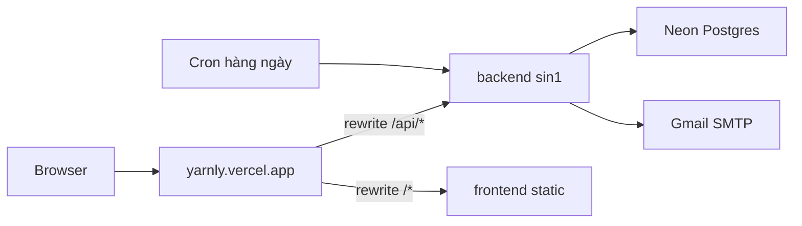

# YARNLY

Website thương mại điện tử bán len và phụ kiện đan móc.

- **Frontend:** React 19 + Vite + TypeScript, React Router, Axios
- **Backend:** Node.js + Express 5, express-validator

## Yêu cầu

- Node.js 22.12 trở lên
- npm 10 trở lên

## Cài đặt và chạy

Yêu cầu Docker Desktop (hoặc Docker Engine).

### Cách 1 — Docker Compose (khuyên dùng)

Chạy toàn bộ stack: PostgreSQL, backend và frontend. Lần đầu cần tạo `backend/.env` (bắt buộc, Docker báo lỗi nếu thiếu); điền thêm Gmail nếu muốn gửi email xác nhận đơn hàng (xem [Email xác nhận đơn hàng](#email-xác-nhận-đơn-hàng)).

```bash
cp backend/.env.example backend/.env
docker compose up -d --build
```

| Dịch vụ | URL |
| ------- | --- |
| Website | http://localhost:5173 |
| API | http://localhost:5000/api |

Dừng: `docker compose down`.

Chỉ cần chạy lệnh trên một lần. Các container có `restart: unless-stopped`, nên mỗi lần mở Docker Desktop chúng tự chạy lại. Thư mục code được gắn thẳng vào container, nên sửa code là container tự cập nhật, không cần chạy lại lệnh:

| Khi sửa | Container làm gì |
| ------- | ---------------- |
| `backend/src`, `backend/scripts`, `backend/db`, `backend/.env` | Backend tự khởi động lại |
| `frontend/src`, `frontend/public`, `index.html`, `vite.config.ts` | Frontend tự reload |
| `package.json`, `package-lock.json` | Chạy lại `docker compose up -d --build` để cài thư viện mới |

### Cách 2 — Chỉ database bằng Docker, code chạy local

Hữu ích khi debug frontend trực tiếp trên Windows.

```bash
docker compose up -d postgres
```

```bash
# Terminal 1 - Backend
cd backend
npm install
cp .env.example .env
npm run dev
```

```bash
# Terminal 2 - Frontend
cd frontend
npm install
npm run dev
```

Trong môi trường dev local, Vite tự chuyển tiếp mọi request `/api` sang backend `http://localhost:5000`, nên frontend không cần file `.env`. Chỉ tạo `frontend/.env` (từ `.env.example`) khi muốn trỏ tới một API khác.

### Email xác nhận đơn hàng

Backend gửi email xác nhận qua Gmail SMTP mỗi khi đặt hàng thành công.

1. Bật xác minh 2 bước cho tài khoản Gmail.
2. Tạo App Password tại https://myaccount.google.com/apppasswords.
3. Điền vào `backend/.env`:

```env
SMTP_USER=tenban@gmail.com
SMTP_PASS=abcdefghijklmnop
SMTP_FROM="Yarnly <tenban@gmail.com>"
```

`SMTP_FROM` phải dùng đúng địa chỉ Gmail ở `SMTP_USER`. Nếu để trống `SMTP_USER`/`SMTP_PASS`, đơn hàng vẫn tạo bình thường nhưng không gửi email. `npm test` không bao giờ gửi email thật. Không commit `backend/.env`.

### Font NVN January

Tiêu đề dùng font `NVN January` theo Figma. Đặt file font vào `frontend/public/fonts/` với tên `NVNJanuary.woff2` (hoặc `.woff`, `.ttf`, `.otf`). Khi chưa có file, trang tự dùng font dự phòng `Paytone One` và lúc build sẽ có cảnh báo `didn't resolve at build time`, không ảnh hưởng kết quả.

### Figma MCP (tùy chọn)

Sao chép `.cursor/mcp.example.json` thành `.cursor/mcp.json` rồi điền `FIGMA_API_KEY`. File `mcp.json` đã nằm trong `.gitignore` nên key không bị commit.

## Scripts

| Thư mục    | Lệnh            | Mô tả                                  |
| ---------- | --------------- | -------------------------------------- |
| `frontend` | `npm run dev`   | Chạy dev server có hot reload          |
| `frontend` | `npm run build` | Kiểm tra type và build production      |
| `frontend` | `npm run lint`  | Kiểm tra code với oxlint               |
| `backend`  | `npm run dev`   | Chạy API với nodemon (tự restart)      |
| `backend`  | `npm start`     | Chạy API ở chế độ production           |
| `backend`  | `npm run vercel-build` | Migrate + seed (Vercel deploy)   |
| `backend`  | `npm run db:migrate`   | Chạy migration SQL               |
| `backend`  | `npm run db:seed`      | Chạy seed (carriers; demo nếu `SEED_DEMO=true`) |
| `backend`  | `npm test`      | Chạy test với Node test runner         |

## Cấu trúc thư mục

```
YARNLY/
├── frontend/
│   ├── public/                  # File tĩnh, không qua build
│   │   ├── fonts/               # Font NVN January
│   │   └── images/              # Logo, ảnh sản phẩm, icon thanh toán, cờ, social
│   └── src/
│       ├── assets/              # Ảnh, font, icon import trong code
│       ├── styles/              # Toàn bộ CSS, tách riêng khỏi component
│       │   ├── global/          # reset, variables, typography
│       │   ├── components/      # CSS cho từng component
│       │   └── pages/           # CSS cho từng trang: buyer/, seller/, admin/
│       ├── components/
│       │   ├── common/          # UI dùng chung: Button, Input, Select, Icon, PageBanner...
│       │   ├── layout/          # BuyerLayout, SellerLayout, AdminLayout, Header, Footer
│       │   └── features/        # Theo tính năng: product, cart, checkout, order, auth...
│       ├── pages/
│       │   ├── buyer/           # Các trang cho người mua (theo Figma)
│       │   ├── seller/          # Trang người bán (đang để trống)
│       │   └── admin/           # Trang quản trị (đang để trống)
│       ├── context/             # State toàn cục (Auth, Cart)
│       ├── hooks/               # Custom hooks (useAuth, useCart, useFetch)
│       ├── services/            # Gọi API backend
│       ├── types/               # TypeScript interfaces
│       ├── utils/               # Hàm tiện ích
│       ├── constants/           # Hằng số (routes, categories, navigation...)
│       ├── routes/              # Cấu hình React Router, RequireRole
│       ├── App.tsx
│       └── main.tsx
│
├── backend/
│   ├── src/
│   │   ├── config/              # Biến môi trường, kết nối database
│   │   ├── routes/              # Khai báo endpoint
│   │   ├── controllers/         # Nhận request, trả response
│   │   ├── services/            # Business logic
│   │   ├── models/              # Dữ liệu (đang dùng in-memory)
│   │   ├── middleware/          # auth, validate, errorHandler
│   │   ├── validators/          # Rule kiểm tra dữ liệu đầu vào
│   │   ├── utils/               # logger, helpers
│   │   ├── app.js               # Cấu hình Express
│   │   └── server.js            # Điểm khởi chạy
│   └── tests/
│
└── docs/                        # Tài liệu dự án
```

Luồng xử lý một request ở backend: `routes` → `middleware` (validate, auth) → `controllers` → `services` → `models`.

## Quy ước

### CSS

Mọi CSS nằm trong `frontend/src/styles/`, không viết CSS trong file `.tsx`. Mỗi component hoặc trang import đúng file CSS của nó, ví dụ `ProductCard.tsx` import `@/styles/components/ProductCard.css`. Màu sắc, khoảng cách, font và bo góc lấy từ biến trong `styles/global/variables.css`. Tên class theo kiểu BEM: `block__element--modifier`.

### Đặt tên

| Loại             | Quy tắc                     | Ví dụ                  |
| ---------------- | --------------------------- | ---------------------- |
| Component folder | PascalCase                  | `ProductCard/`         |
| Component file   | PascalCase.tsx              | `ProductCard.tsx`      |
| CSS file         | PascalCase.css              | `ProductCard.css`      |
| Hook             | camelCase, tiền tố `use`    | `useCart.ts`           |
| Service          | camelCase, hậu tố `Service` | `productService.ts`    |
| Backend file     | camelCase                   | `productController.js` |
| API route        | kebab-case                  | `/api/products`        |

### Import

Frontend dùng alias `@/` trỏ tới `frontend/src/`, ví dụ `import Button from '@/components/common/Button'`.

## Vai trò người dùng

- `admin`: quản trị, vào `/admin`.
- `user` gồm hai loại `userType`: `buyer` (người mua) và `seller` (người bán, vào `/seller`).

`RequireRole` trong `src/routes/` chặn route theo vai trò: chưa đăng nhập thì chuyển tới trang đăng nhập, sai vai trò thì về trang chủ. Hiện chỉ giao diện người mua được làm theo Figma; trang seller và admin mới có khung trống.

## Trạng thái hiện tại

- Trang người mua đã chạy được: trang chủ, sản phẩm (lọc, sắp xếp, phân trang), chi tiết sản phẩm (chọn màu, size, thời gian làm), thiết kế riêng, blind box, giỏ hàng (lưu ở trình duyệt), thanh toán, đặt hàng thành công, tra cứu đơn hàng theo số điện thoại hoặc email.
- Phí vận chuyển theo 3 đơn vị (Yarnly Express, GHN, Viettel Post) và khu vực: Đà Nẵng (local), Huế/Quảng Nam (nearby), còn lại (national). Giá thiết kế riêng được backend tính lại khi đặt hàng.
- Sản phẩm hiển thị người bán; 3 tài khoản seller mẫu trong seed (`seller@yarnly.vn`, `hoa.len@yarnly.vn`, `thu.len@yarnly.vn`, mật khẩu `yarnly-seller`).
- Chưa triển khai (API trả về 501): đăng ký/đăng nhập social, mã giảm giá, thanh toán MoMo/ZaloPay trực tuyến.
- Dữ liệu lưu PostgreSQL (Docker). Email xác nhận đơn hàng gửi qua Gmail SMTP.

Danh sách endpoint chi tiết xem tại [docs/api.md](docs/api.md).

## Deploy lên Vercel (miễn phí)

Stack $0: **Vercel Hobby** (một project, [Vercel Services](https://vercel.com/docs/services)), **Neon Postgres** (free tier qua Marketplace), **Gmail SMTP**, **Vercel Cron** (1 lần/ngày trên Hobby).

Cấu hình monorepo nằm ở [vercel.json](vercel.json) gốc repo: service `backend` (Express) + `frontend` (Vite), routing công khai `/api/*` → backend, còn lại → frontend.



### Thiết lập project

1. Import repo GitHub `copengoknghek/YARNLY` trên Vercel (**Root Directory:** repo gốc, không chọn `frontend` hay `backend`).
2. Thêm integration **Neon** (region Singapore `ap-southeast-1`). Dùng connection string **pooled** có `sslmode=require`.
3. **Environment variables** (Production, shared project):

| Biến | Giá trị |
| ---- | ------- |
| `NODE_ENV` | `production` |
| `JWT_SECRET` | Chuỗi ngẫu nhiên ≥ 32 ký tự |
| `CRON_SECRET` | Chuỗi ngẫu nhiên (route cron kiểm tra `Authorization: Bearer …`) |
| `CLIENT_URL` | `https://<tên-project>.vercel.app` (có thể thêm preview URL, phân tách bằng dấu phẩy) |
| `SEED_DEMO` | `true` lần deploy đầu, sau đó `false` |
| `SMTP_*` | Gmail App Password (xem [Email](#email-xác-nhận-đơn-hàng)) |

4. Deploy. Service `backend` chạy `vercel-build` (migrate + seed); runtime tại `backend/api/index.js`.

Kiểm tra: `https://<project>.vercel.app/api/health` và đăng nhập thử. Frontend không cần `VITE_API_URL` (axios dùng `/api` cùng domain).

Dev local với routing giống production: `vercel dev` (hoặc `vercel dev -L`). Docker Compose / `npm run dev` vẫn dùng proxy Vite như trước.

### Giới hạn free tier

| Dịch vụ | Lưu ý |
| ------- | ----- |
| Vercel Hobby | 1 cron/ngày; function cold start |
| Neon free | Giới hạn storage/compute; DB tạm dừng sau ~5 phút idle (request đầu chậm hơn) |
| Gmail SMTP | ~500 email/ngày |

Docker Compose vẫn dùng cho dev local; production không dùng `docker-compose.yml`.
